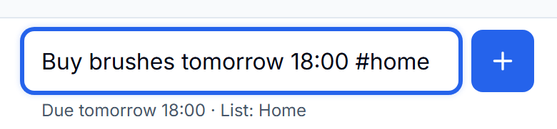
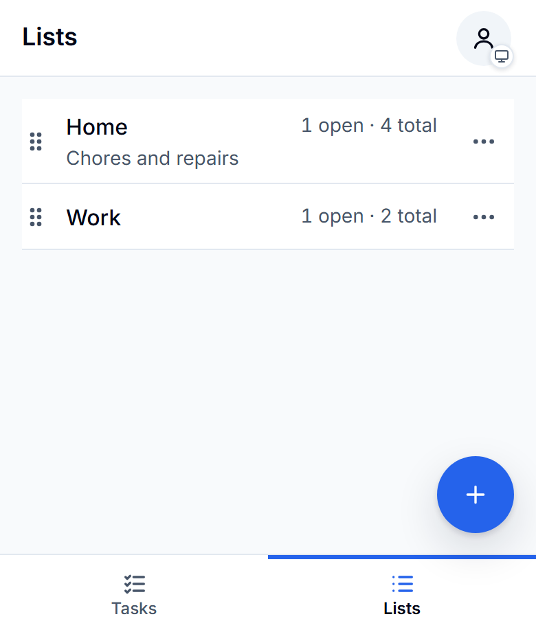
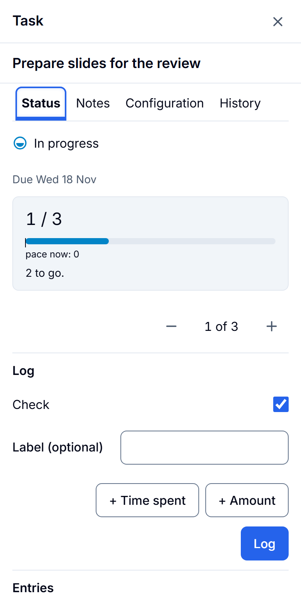
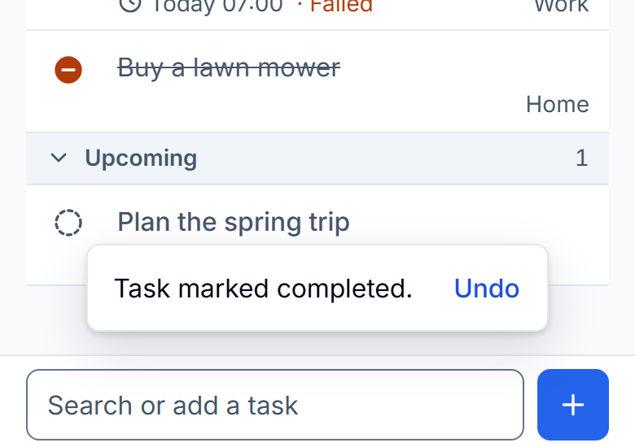
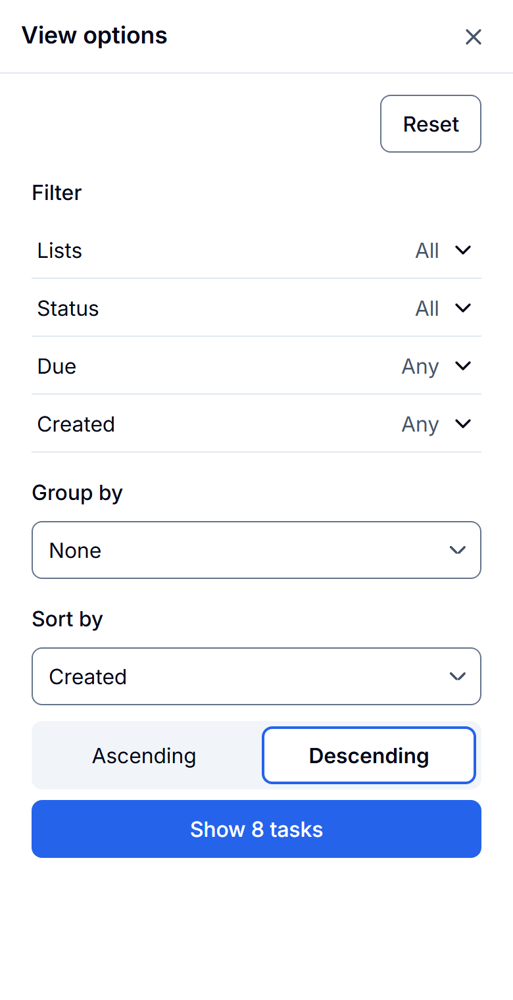
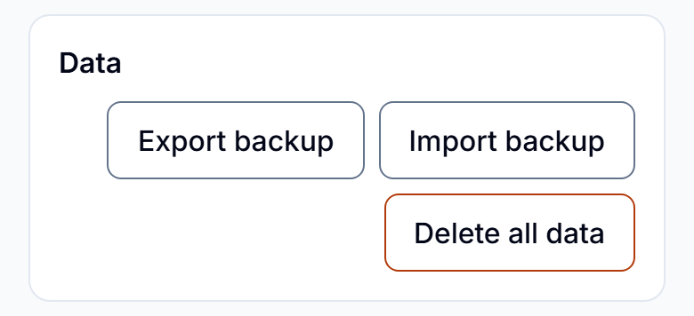
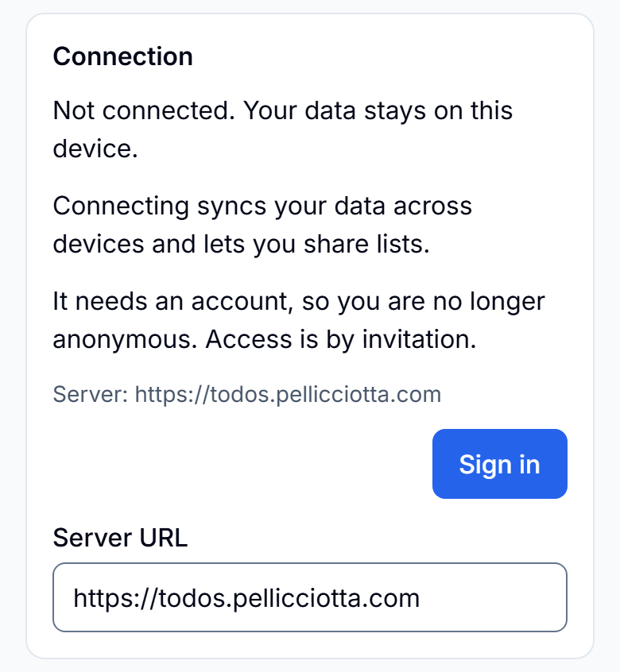

# Getting Started Tutorial

This tutorial takes you from your first task to installing the app.
Each step takes about a minute, and you can skip any of them.

## 1. Add your first task
Open [All tasks](https://todos.pellicciotta.com/#/tasks). Click the field that reads "Search or add a task", and type what you need to do.
Press `Enter`, or click the  button, to add it.
Press `n` or `/` to jump to the field.

## 2. Set a due date, time, and list by typing
Type the details with the task, such as `Buy brushes tomorrow 18:00 #home`.
A preview line shows what ToDo's will set before you add the task.

- Dates: `today`, `tomorrow`, a full weekday such as `friday`, or `2026-12-24`.
- Times: `18:00`, `6 pm`, or `6:30 am`.
- Lists: `#home` adds the task to the list named Home.
- A backslash keeps a word as plain text, such as `\tomorrow`.

## 3. Create a list and open it
Open [Lists](https://todos.pellicciotta.com/#/lists) and choose the  button.
Type a name, such as Home, and press `Enter`. Then close the panel and open the list.
A task you add inside a list joins that list.

## 4. Open a task to edit it
Click a task to open its editor. Its description stays above the tabs.

- **Status:** the progress, the log form, and the entries.
- **Notes:** what you want to remember about the task.
- **Configuration:** the description, lists, goal, recurrence, and due time.
- **History:** what happened to the task, and when.

Press `Escape` to close the editor.

## 5. Tick tasks off, and undo
Click the status button of a task, or focus the task and press `x`, to tick it off.
Made a mistake? Click **Undo** in the toast, or press `Ctrl+Z`.

## 6. Find your tasks
Type in the search and add field to filter tasks by their description or notes.
Choose  in the top bar, then [Edit view options](https://todos.pellicciotta.com/#/tasks/view-options), to filter, group, and sort.

## 7. Export a backup
Open [Settings, Data](https://todos.pellicciotta.com/#/settings?section=data) and choose **Export backup**.
It saves all your lists and tasks in one file.
Keep it somewhere safe, or use it to move your data to another device.

## 8. Connect to sync and share
This step is optional.
In [Settings, Connection](https://todos.pellicciotta.com/#/connect), sign in to sync across devices and to share lists.
Access is by invitation, so ask someone who uses ToDo's to invite you.
Once connected, turn on [reminders](https://todos.pellicciotta.com/#/settings?section=reminders) to be told when tasks come due.

## 9. Install the app
Use your browser's install option to add ToDo's to your phone or computer.
Once installed, it opens like any other app and works without a network.
