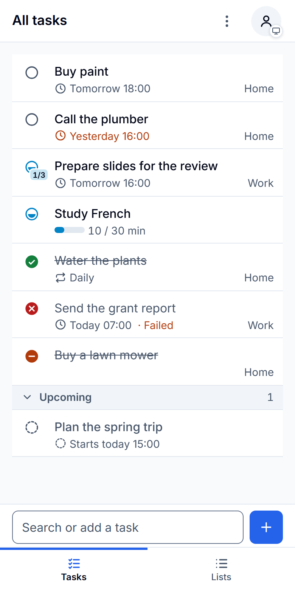
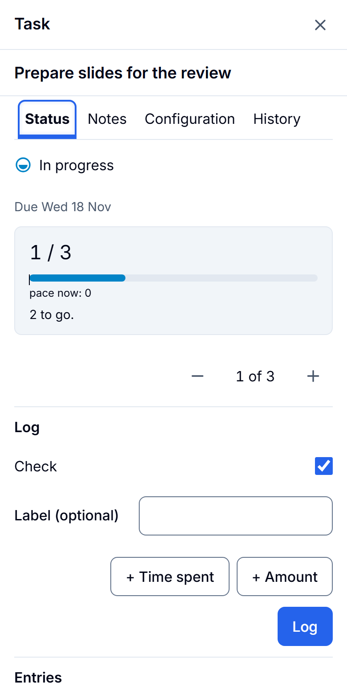
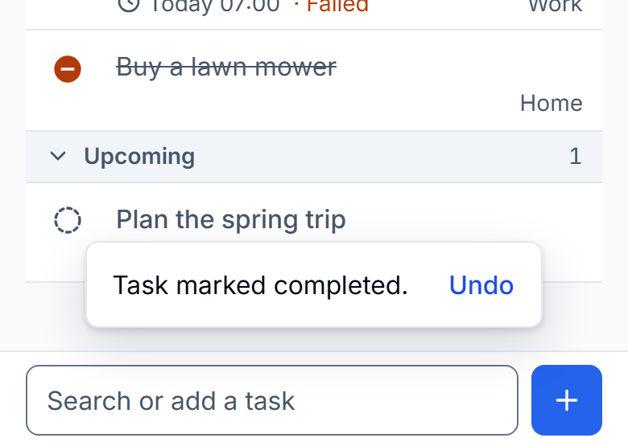
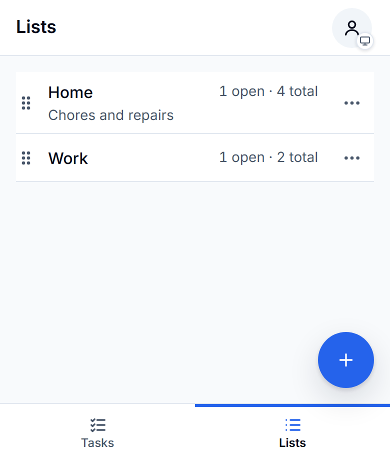
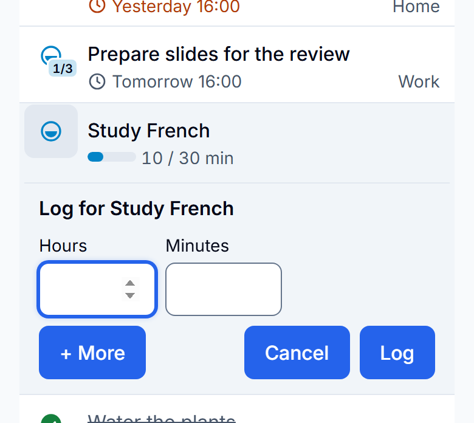
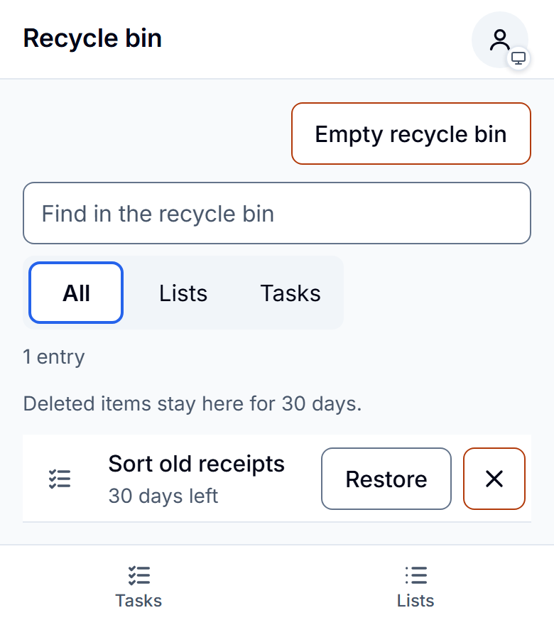

# Welcome to ToDo's

ToDo's is a personal task manager that works offline, on your phone or computer.
Your tasks stay on your device until you choose to connect.

Read on for the main ideas. The [Getting Started Tutorial](https://todos.pellicciotta.com/#/help?topic=tutorial) walks you through them step by step.

## Tasks
A task has a description, optional notes, and an optional due time.
Add one in the search and add field of [All tasks](https://todos.pellicciotta.com/#/tasks), with `Enter` or the  button.
Open a task to change it. Its tabs hold the **Status**, **Notes**, **Configuration**, and **History**.

## Statuses
The button at the start of a row shows the status of the task.

| Icon                                             | Status      | What it means                                           |
|:-------------------------------------------------|:------------|:--------------------------------------------------------|
|              | To do       | Open, and not started yet.                              |
|  | In progress | Started. It turns orange when the task is not on track. |
|      | Completed   | The goal is met.                                        |
|            | Failed      | The time window closed before the goal was met.         |
|      | Cancelled   | You dropped the task.                                   |
|        | Upcoming    | It starts later, so it takes no logs yet.               |

Click the status button to tick a task off. A toast offers **Undo** right after.

## Lists
A task can sit in several lists, or in none.
[All tasks](https://todos.pellicciotta.com/#/tasks) shows every task, whatever its lists.
Open your lists on the [Lists](https://todos.pellicciotta.com/#/lists) screen, where the  button creates one.

## Due times and overdue tasks
Give a task a due date, a time, or both. 
A date without a time means the end of that day, at 23:59.
A task is overdue once its due time passes while it is still open, and its due text turns orange.
It stays open, unless you set **When overdue** to **Fail** in its configuration.

## Repeating tasks and target counts
A task can repeat daily, weekly, monthly, or yearly. 
It comes back as *To do* each period.
A goal can ask for several checks, such as 3 times a week. The row then shows a count like `1/3`.
A goal can also measure time spent, amounts, or readings; its status button then opens a quick log.

## Search and view options
The search and add field filters your tasks as you type.
Choose  in the top bar, then [Edit view options](https://todos.pellicciotta.com/#/tasks/view-options), to filter, group, and sort.
On wide screens, a line under the field lists what is active, and **Reset** clears it.

## Local and connected mode
Without an account, your data stays on this device and never leaves it.
[Connect](https://todos.pellicciotta.com/#/connect) to sync your tasks across your devices and to share lists.
Connecting needs an account, and access is by invitation. You can disconnect at any time in [Settings](https://todos.pellicciotta.com/#/settings).

## Recycle bin
Deleted lists and tasks go to the  [recycle bin](https://todos.pellicciotta.com/#/bin) and stay there for 30 days.
Restore them from the bin until then. After 30 days, ToDo's deletes them for good.
The user button in the top bar opens the bin too.

