## Walkthrough & Validation

The List screen fills `#/lists/{{list-id}}` with the header, order buttons, status chip, add bar, and rows.
reorder.js turns drags, Alt+Up and Alt+Down, and Move up and Move down into one store neighbor.
Commands ran in a clean work copy of `main`; the e2e server used port 8851.

### Red Phase

The new tests failed before list.js and reorder.js existed.

Command: `npx vitest run tests/unit/reorder.test.js` (exit code 1)

```text

 RUN  v5.1.0 C:/Users/giova/AppData/Local/Temp/claude/c--Dev-Projects-todos-webapp/2ef3bbc3-e820-4103-9d60-421b54f7c558/scratchpad/t17work

 ❯ tests/unit/reorder.test.js (0 test)

⎯⎯⎯⎯⎯⎯ Failed Suites 1 ⎯⎯⎯⎯⎯⎯⎯

 FAIL  tests/unit/reorder.test.js [ tests/unit/reorder.test.js ]
Error: Failed to resolve import "../../src/js/views/reorder.js" from "tests/unit/reorder.test.js". Does the file exist?
  Plugin: vite:import-analysis
  File: C:/Users/giova/AppData/Local/Temp/claude/c--Dev-Projects-todos-webapp/2ef3bbc3-e820-4103-9d60-421b54f7c558/scratchpad/t17work/tests/unit/reorder.test.js:3:65
  1  |  // @vitest-environment happy-dom
[... 14 lines omitted ...]


 Test Files  1 failed (1)
      Tests  no tests
   Start at  21:29:36
   Duration  967ms (environment 99%, worker 1%)
```

Command: `E2E_PORT=8851 npx playwright test tests/e2e/list.spec.js` (exit code 1)

```text

Running 4 tests using 4 workers

  x  2 [chromium] › tests\e2e\list.spec.js:91:3 › List screen › Alt+Down moves the focused row, keeps focus on it, and announces the move (LV-3) (6.0s)
  x  1 [chromium] › tests\e2e\list.spec.js:111:3 › List screen › a sorted view hides the move controls and leaves the stored order unchanged (LV-7, LV-8) (6.3s)
  x  4 [chromium] › tests\e2e\list.spec.js:59:3 › List screen › shows the header, the open tasks in manual order, and the status filter (LV-1, LV-2, LV-10) (6.2s)
  x  3 [chromium] › tests\e2e\list.spec.js:71:3 › List screen › dragging a row by its handle stores the new order, which survives a reload (LV-3) (6.4s)


  1) [chromium] › tests\e2e\list.spec.js:59:3 › List screen › shows the header, the open tasks in manual order, and the status filter (LV-1, LV-2, LV-10) 

    Error: expect(locator).toHaveCount(expected) failed

    Locator:  locator('.list-view .task-row')
    Expected: 3
    Received: 0
    Timeout:  5000ms

    Call log:
      - Expect "toHaveCount" locator('.list-view .task-row') with timeout 5000ms
      - waiting for locator('.list-view .task-row')
        14 × locator resolved to 0 elements
           - unexpected value "0"

[... 128 lines omitted ...]

  4 failed
    [chromium] › tests\e2e\list.spec.js:59:3 › List screen › shows the header, the open tasks in manual order, and the status filter (LV-1, LV-2, LV-10) 
    [chromium] › tests\e2e\list.spec.js:71:3 › List screen › dragging a row by its handle stores the new order, which survives a reload (LV-3) 
    [chromium] › tests\e2e\list.spec.js:91:3 › List screen › Alt+Down moves the focused row, keeps focus on it, and announces the move (LV-3) 
    [chromium] › tests\e2e\list.spec.js:111:3 › List screen › a sorted view hides the move controls and leaves the stored order unchanged (LV-7, LV-8) 
```

The status button check of the Alt+Down test came during implementation.
Reverting the `event.altKey` guard in task-list.js made it fail, as shown:

Command: `E2E_PORT=8851 npx playwright test tests/e2e/list.spec.js -g "Alt"` (exit code 1)

```text

Running 1 test using 1 worker

  x  1 [chromium] › tests\e2e\list.spec.js:91:3 › List screen › Alt+Down moves the focused row, keeps focus on it, and announces the move (LV-3) (6.2s)


  1) [chromium] › tests\e2e\list.spec.js:91:3 › List screen › Alt+Down moves the focused row, keeps focus on it, and announces the move (LV-3) 

    Error: expect(locator).toBeFocused() failed

    Locator:  locator('.list-view .task-row').nth(1).locator('.status-button')
    Expected: focused
    Received: inactive
    Timeout:  5000ms

    Call log:
      - Expect "toBeFocused" locator('.list-view .task-row').nth(1).locator('.status-button') with timeout 5000ms
      - waiting for locator('.list-view .task-row').nth(1).locator('.status-button')
        14 × locator resolved to <button type="button" data-role="status" aria-haspopup="menu" aria-expanded="true" class="icon-button status-button" aria-controls="task-list-2-status" aria-label="Status of Clean the gutters: To do">…</button>
           - unexpected value "inactive"

[... 18 lines omitted ...]
    ────────────────────────────────────────────────────────────────────────────────────────────────

  1 failed
    [chromium] › tests\e2e\list.spec.js:91:3 › List screen › Alt+Down moves the focused row, keeps focus on it, and announces the move (LV-3) 
```

### Green Phase

Command: `npm test` (exit code 0)

```text

> todos-webapp@0.1.0-pre test
> vitest run


 RUN  v5.1.0 C:/Users/giova/AppData/Local/Temp/claude/c--Dev-Projects-todos-webapp/2ef3bbc3-e820-4103-9d60-421b54f7c558/scratchpad/t17work


 Test Files  27 passed (27)
      Tests  558 passed (558)
   Start at  21:38:34
   Duration  5.48s (environment 68%, tests 19%, import 10%, transform 2%, worker 2%)

    Isolate  27 workers spawned · ~931ms startup each (spawn + environment, per file)
             at least ~2.66s faster with isolate: false — reuses workers across files instead of one per file
```

`npx eslint .` printed nothing.

Command: `npx eslint .` (exit code 0)

```text

```

Command: `npm run check:sw` (exit code 0)

```text

> todos-webapp@0.1.0-pre check:sw
> node scripts/check-sw-version.mjs

OK: 48 precached files match VERSION 2026-11-04.14.
```

Command: `E2E_PORT=8851 npx playwright test` (exit code 0)

```text

Running 98 tests using 4 workers

[... 88 lines omitted ...]
  ok 90 [chromium] › tests\e2e\shell.spec.js:199:1 › a newer app version in another tab shows a lasting banner with Reload (897ms)
  ok 91 [chromium] › tests\e2e\shell.spec.js:223:1 › a start-up failure shows an error banner instead of a broken page (780ms)
  ok 92 [chromium] › tests\e2e\task-editor.spec.js:64:3 › the editor opens from a row with focus on the description, and Escape returns to the row at 390 px (1.0s)
  ok 93 [chromium] › tests\e2e\task-editor.spec.js:64:3 › the editor opens from a row with focus on the description, and Escape returns to the row at 1440 px (1.2s)
  ok 63 [chromium] › tests\e2e\gallery-controls.spec.js:121:3 › every keyboard stop in the control sections shows a focus ring at 1440 px (19.7s)
  ok 94 [chromium] › tests\e2e\task-editor.spec.js:87:1 › every field saves on change without a Save button, and the changes survive a reload (TSK-1 to TSK-7) (2.7s)
  ok 95 [chromium] › tests\e2e\task-editor.spec.js:122:1 › typing a due date by keyboard saves nothing until focus leaves the due fields (2.0s)
  ok 96 [chromium] › tests\e2e\task-editor.spec.js:149:1 › the Add to list box adds the task to an existing list or a new one, and chips remove it (TSK-8) (2.0s)
  ok 97 [chromium] › tests\e2e\task-editor.spec.js:173:1 › a new note appears at the top, editing marks it edited, and deleting asks in place (NOT-1 to NOT-5) (2.3s)
  ok 98 [chromium] › tests\e2e\task-editor.spec.js:205:1 › Delete task moves it to the recycle bin with an Undo toast, and a deleted task opens read-only (TSK-11, BIN-6) (1.6s)

  98 passed (1.4m)
```

### Visual Check

A throwaway Playwright script seeded a Home list with tasks of every status.
It captured `#/lists/{{list-id}}` at 390 and 1440 px in light and dark, with no console errors.
After screenshots also show the Due order and every status.

| Viewport | Before                                         | After                                        | Sorted                                              | All statuses                                     |
| :------- | :--------------------------------------------- | :------------------------------------------- | :-------------------------------------------------- | :----------------------------------------------- |
| 390 light | 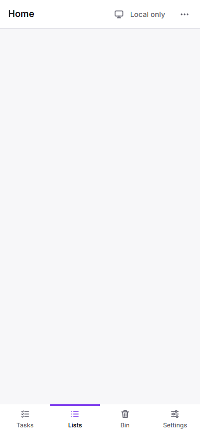 | 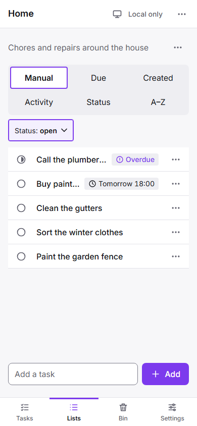 | 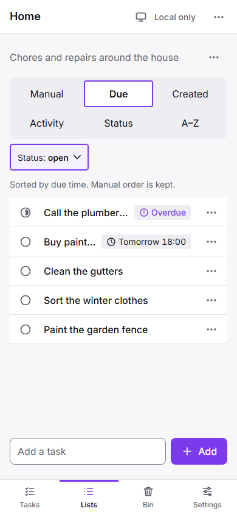 | 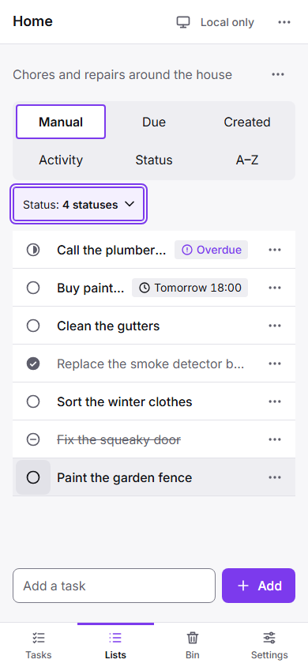 |
| 390 dark  | 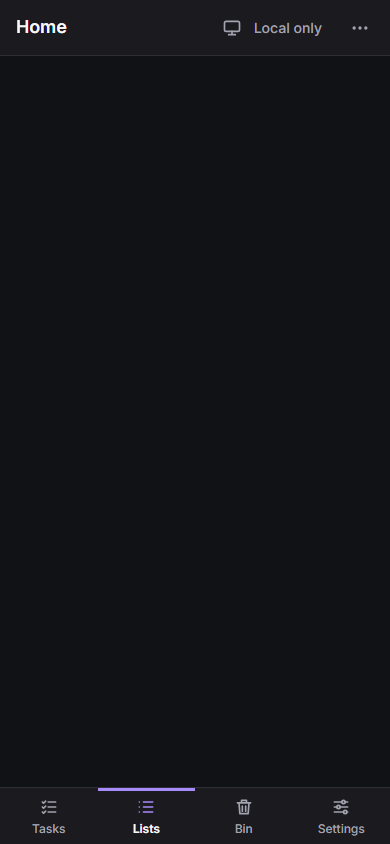 | 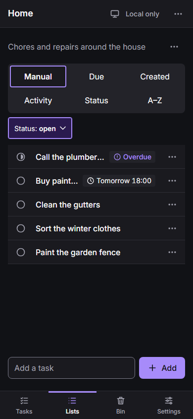 | 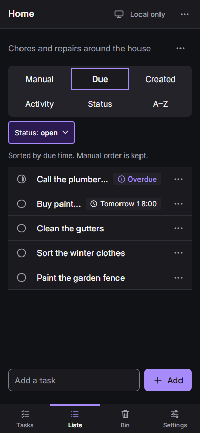 | 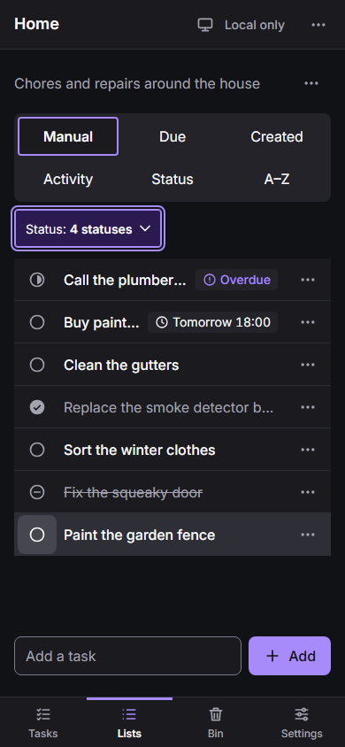 |
| 1440 light | 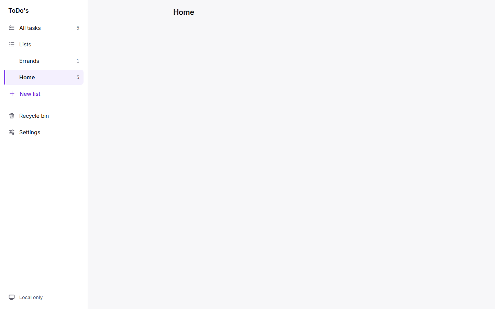 | 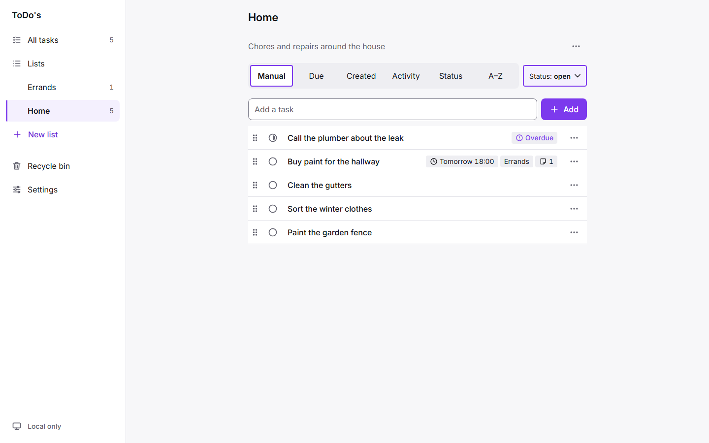 | 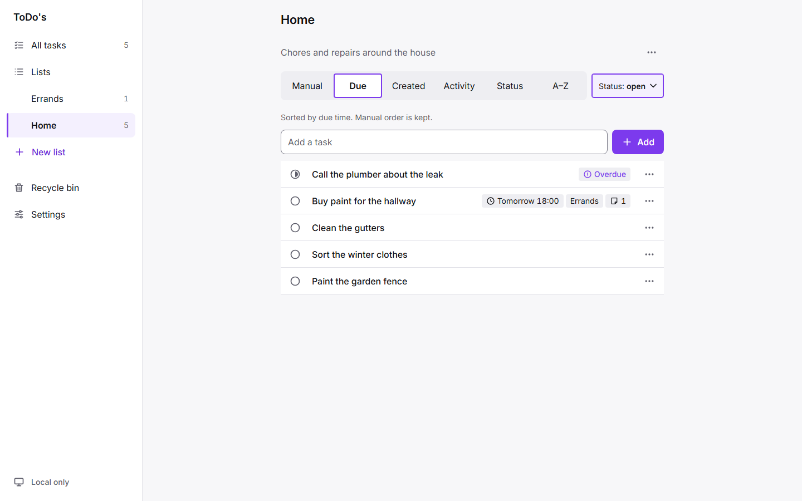 | 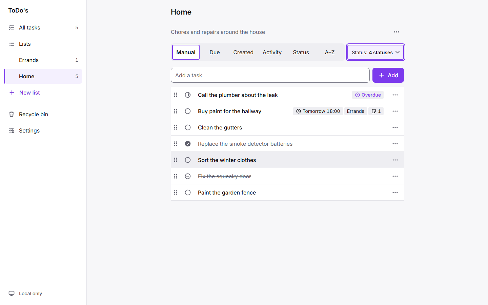 |
| 1440 dark  | 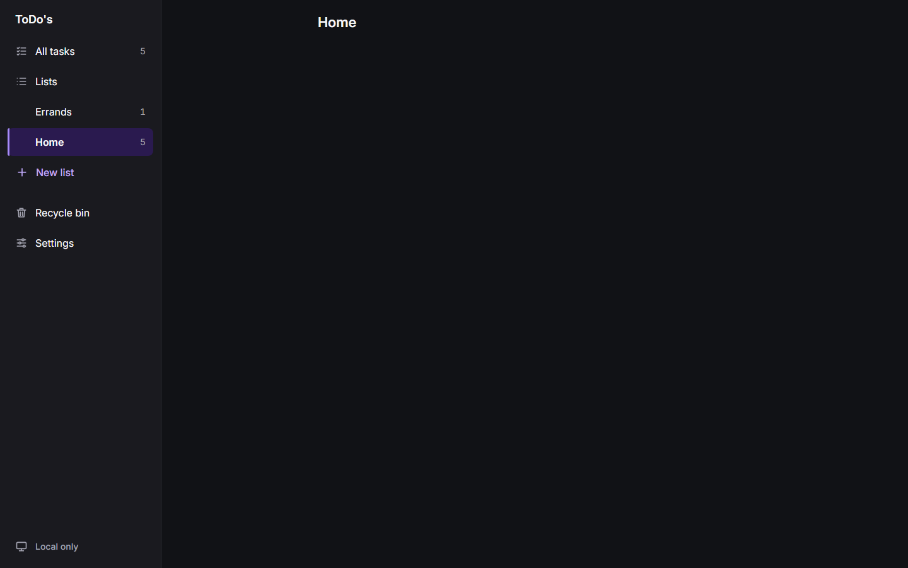 | 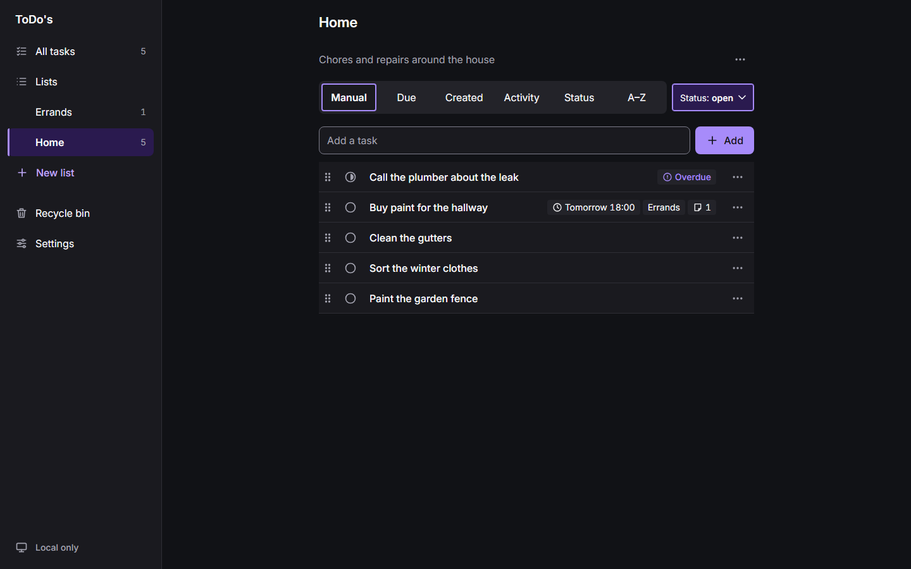 | 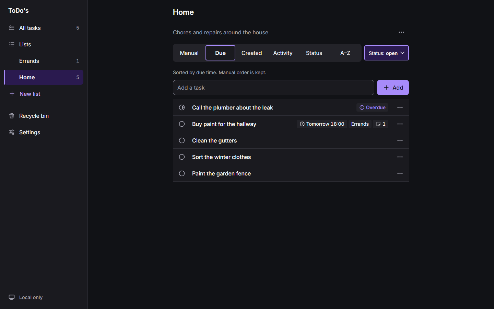 | 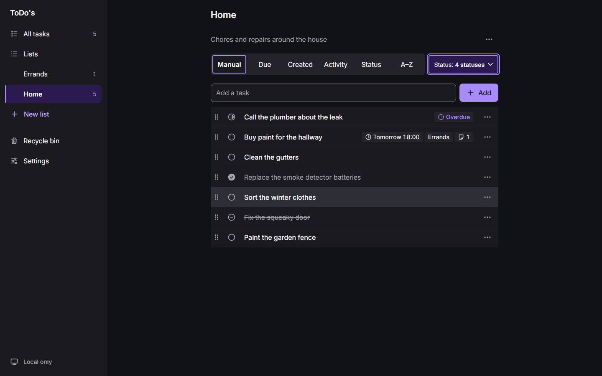 |
