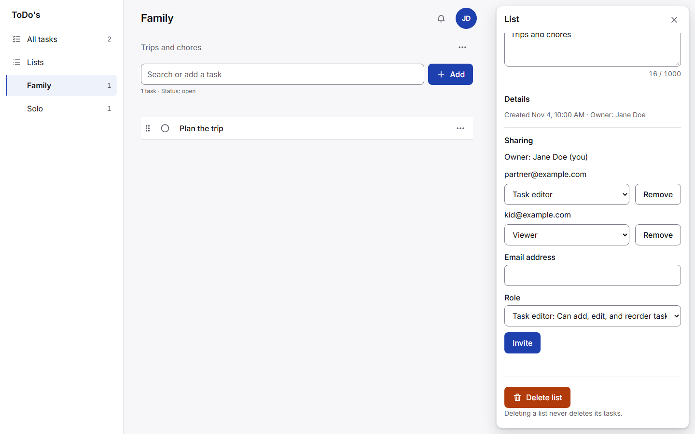
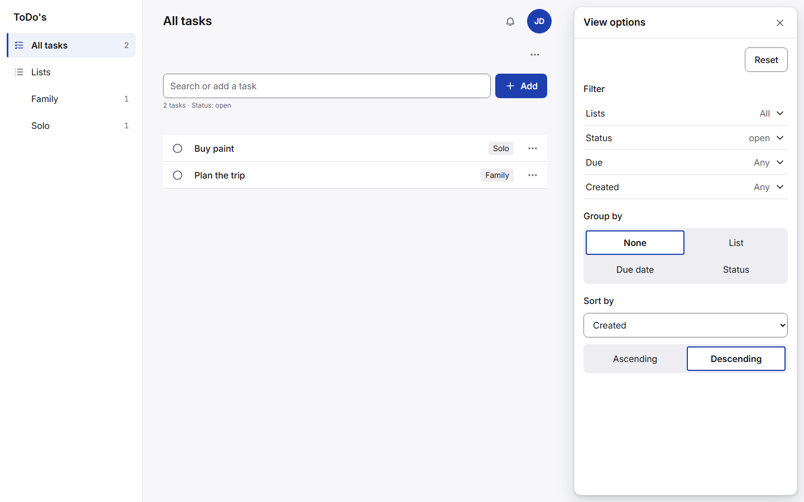
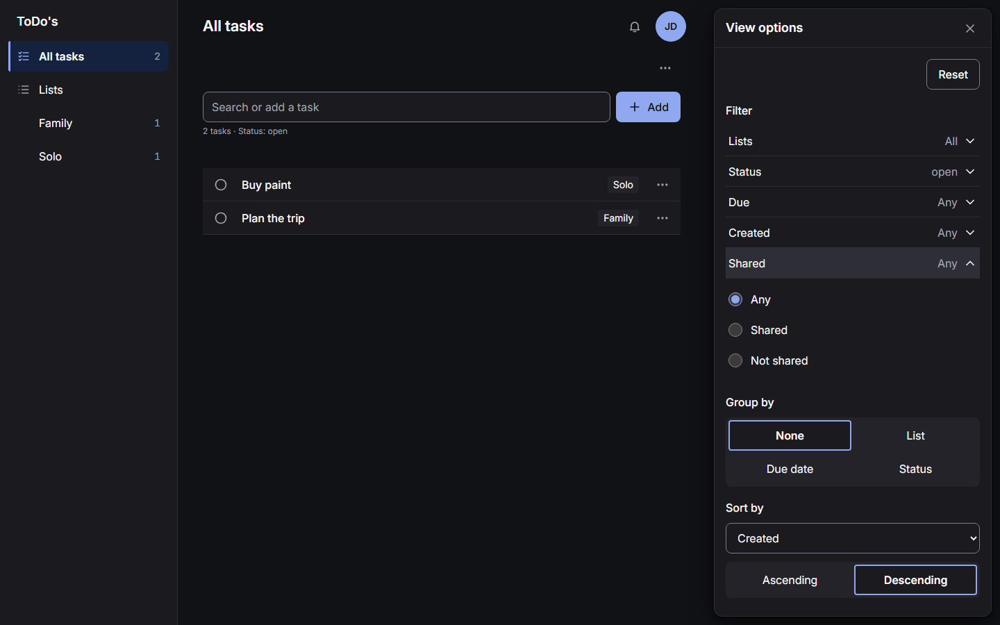
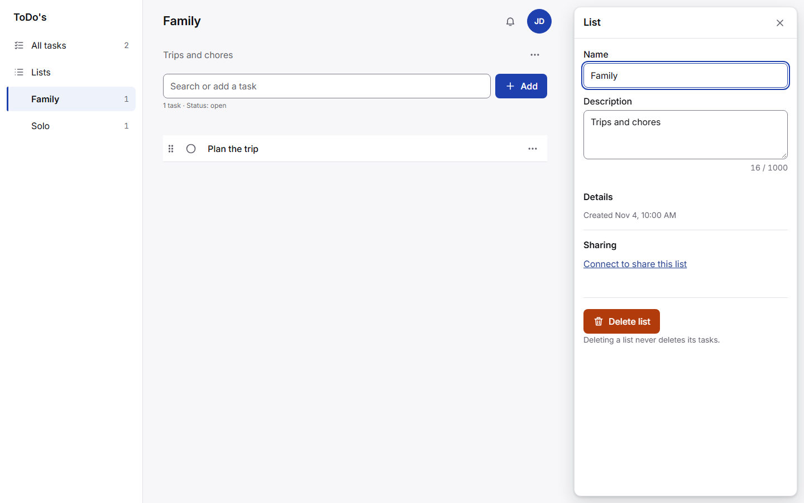

# T0028: Add the Sharing section to the list editor, role-aware controls, and the Shared filter

## Goals
Build the list editor's Sharing section per docs/specs/ui-design.md: invite, change role, remove (`SHR-1` to `SHR-3`).
Disable sharing controls while offline with a banner (`SHR-6`).
Offer only the actions the user's role allows on every screen (`SHR-4`, `SHR-5`).
Add the Shared filter to All tasks while connected (`TV-7`).
See technical-spec.md for decisions, files, size, and tests.

## Task Execution Steps
- [x] **[Read]**      Read the requirements' Sharing section, the service's permission table, and the list editor wireframe.
- [x] **[Implement]** Write the failing unit and integration tests listed in technical-spec.md.
- [x] **[Verify]**    Run the new tests, confirm they fail as expected, and record the output in validation-proof.md.
- [x] **[Implement]** Write the permissions module and the Sharing section, and hide disallowed actions.
- [x] **[Verify]**    Run the completion check and record its verbatim output in validation-proof.md.
- [x] **[Visual]**    Capture before and after screenshots at 390 and 1440 px in light and dark themes.
- [x] **[Doc]**       Update ui-design.md where the build differs and update CHANGELOG.md.
- [x] **[Review]**    Obtain review approval of the finished work before completion.

## Visual Verification
- Before, list editor: 
- After, list editor: 
- Before, view options: 
- After, view options with Shared: 
- All 16 captures, at 390 and 1440 px in both themes, are in the companion `screenshots/` folder.

## Execution Log
- [2026-11-04] **[Doc]**
  Companion task file scaffolded at task creation.

- [2026-11-04] **[Review]**
  Review raised from agent to human.

- [2026-11-04] **[Review]**
  Review lowered from human to agent by @gpellicciotta: The user authorized agent review for all v0.1.0 tasks on 2026-11-04, to work without waiting for each review..

- [2026-11-07] **[Verify]**
  Recorded task outcomes.
  - Files touched: 28.
  - Lines touched: 1857.
  - Reopenings: 0.

- [2026-11-07] **[Decided]**
  Size note: diff exceeds the large line and three times the estimate; SHR-4 needs role-aware actions on every screen. Sign-off needed.

- [2026-11-07] **[Read]**
  Read requirements, the service permission table, and the wireframe.

- [2026-11-07] **[Implement]**
  Wrote failing tests, then permissions.js, sharing.js, role-aware screens, and the Shared filter.

- [2026-11-07] **[Visual]**
  Captured before and after screens at 390 and 1440 px, light and dark: [after list editor](T0028-add-the-sharing-section-to-the-list-editor/screenshots/after-list-editor-1440-light.png).

- [2026-11-07] **[Doc]**
  Updated ui-design.md and CHANGELOG.md.

- [2026-11-07] **[Visual]**
  Before: [list editor](T0028-add-the-sharing-section-to-the-list-editor/screenshots/before-list-editor-1440-light.png), [view options](T0028-add-the-sharing-section-to-the-list-editor/screenshots/before-view-options-1440-light.png).

- [2026-11-07] **[Visual]**
  After: [view options](T0028-add-the-sharing-section-to-the-list-editor/screenshots/after-view-options-1440-dark.png), [list editor 390](T0028-add-the-sharing-section-to-the-list-editor/screenshots/after-list-editor-390-light.png).

- [2026-11-07] **[Visual]**
  Screens:  .

- [2026-11-07] **[Review]**
  Suspended for size sign-off: diff exceeds the large line and three times the estimate. Work is committed and verified; a human decides whether to approve.

- [2026-11-07] **[Size]**
  Size approval requested by the work loop: 30 files, 1897 lines exceeds 3x the approved 6 files, 450 lines.

- [2026-11-07] **[Size]**
  Size approved by @gpellicciotta for 30 files, 1897 lines.

- [2026-11-07] **[Review]**
  Size approved by @gpellicciotta for 30 files and 1897 lines. All steps except Review are checked; work is committed and verified.

- [2026-11-07] **[Review]**
  Round 1 requested (mode: agent).

- [2026-11-07] **[Review]**
  Round 1 rejected by @gemini: Rejected.
  - Findings: [review-findings-1.md](T0028-add-the-sharing-section-to-the-list-editor/review-findings-1.md).

- [2026-11-07] **[Implement]**
  Rework for round 1: resolved the rebase conflicts, counted lists shared with the user as shared, and steadied two e2e specs.

- [2026-11-07] **[Verify]**
  Fresh green run after rework: 1130 unit tests, lint, check:sw, and 184 e2e tests passed.

- [2026-11-07] **[Doc]**
  Removed the temporary capture scripts from the companion folder; the proof describes the method.

- [2026-11-07] **[Review]**
  Round 2 requested (mode: agent).

- [2026-11-07] **[Review]**
  Round 2 approved by @gemini: Approved.
  - Findings: [review-findings-2.md](T0028-add-the-sharing-section-to-the-list-editor/review-findings-2.md).

- [2026-11-07] **[Complete]**
  Task completed successfully.

