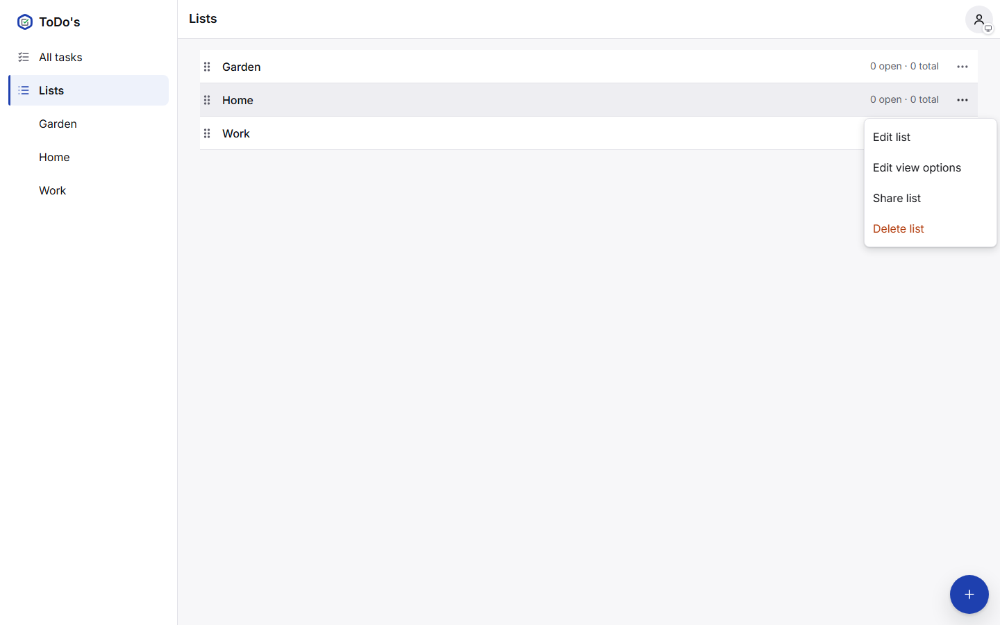
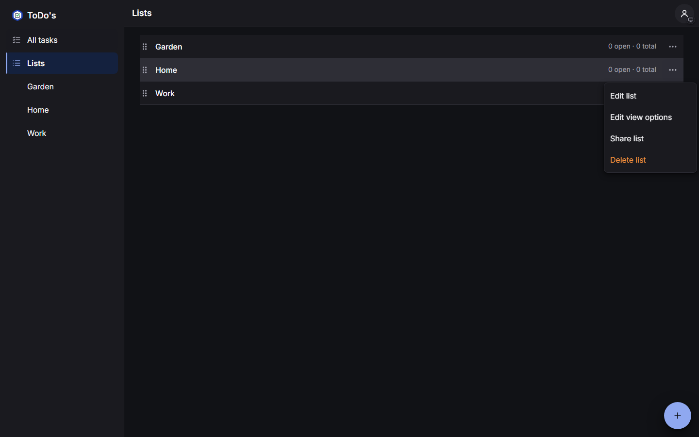
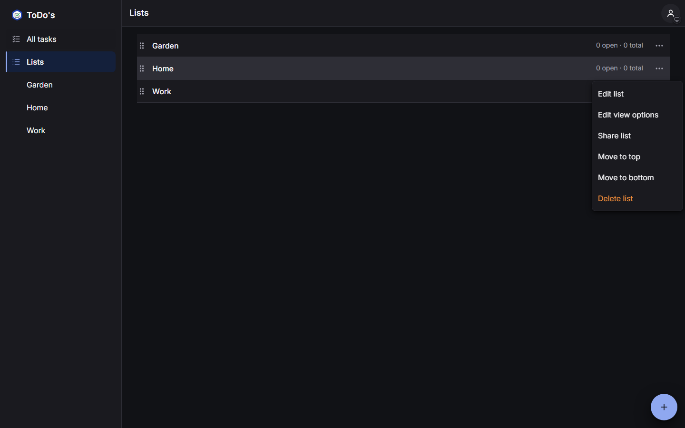
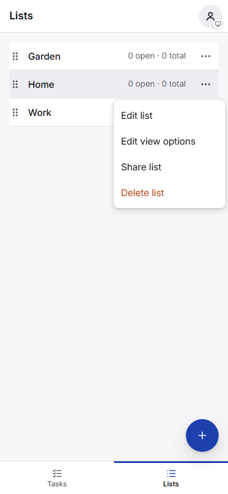
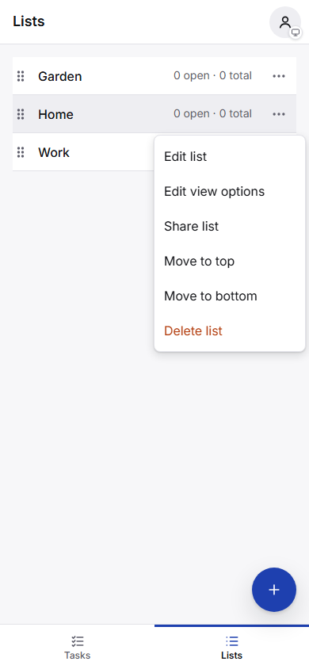
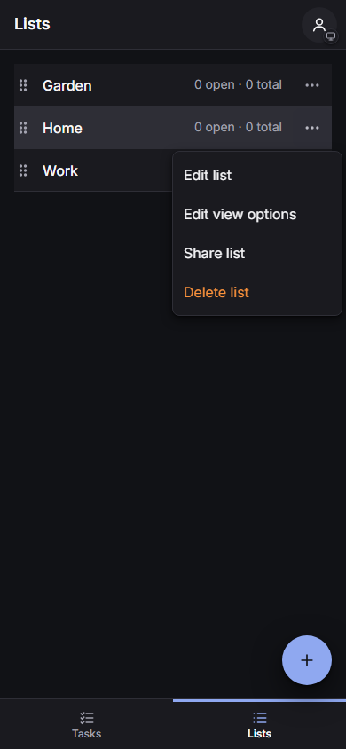
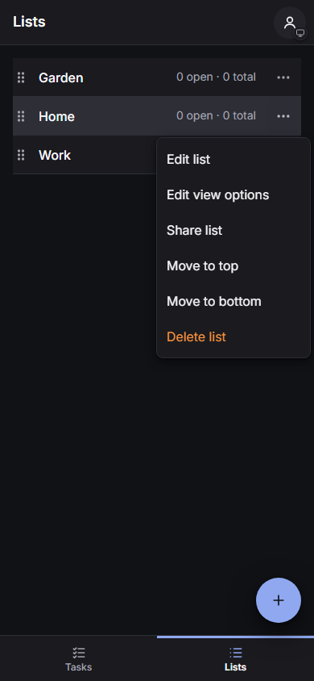

## Walkthrough & Validation

### Key changes
- `moveListToEnd` in `src/js/core/list-order.js` moves a list to the first or last place.
- The Lists screen row menu adds Move to top and Move to bottom before Delete list while reordering is on.
  A row at an end leaves out that end; the List screen header menu never shows them.
- The Lists screen turns on the `ends` option of reorder.js, so Alt+Home and Alt+End reuse its `jump`.
  The menu entries call the same `jump`. The reorder lock announces its reason for Alt+Home and Alt+End too.
- The sidebar takes Alt+Home and Alt+End on a focused list link.
- Each move announces "{{list}} moved to position {{n}} of {{count}}." and keeps the row focused and scrolled into view.
- Settings lists Alt+Home and Alt+End in Keyboard shortcuts.
- The service worker `VERSION` moved to `2026-11-17.30`, and the precache hash manifest was updated.

### Red phase: the new tests fail before the code exists

`npx vitest run tests/unit/list-order.test.js tests/unit/lists.test.js tests/unit/layout.test.js tests/unit/settings.test.js` (exit code 1)

```text
 ❯ tests/unit/list-order.test.js (15 tests | 2 failed) 59ms
   ❯ moveListToEnd (LST-13) (2)
     × moves a list to the first or the last position 11ms
     × keeps the order of a list already at that end, and of an unknown list 2ms
 ❯ tests/unit/layout.test.js (28 tests | 1 failed) 975ms
   ❯ renderShell list order (5)
     × moves the focused list to the bottom with Alt+End and to the top with Alt+Home, keeps focus, and announces it (LST-13) 54ms
 ❯ tests/unit/settings.test.js (51 tests | 2 failed) 1556ms
   ❯ Keyboard shortcuts section (4)
     × lists the ten shortcuts under a Keyboard shortcuts heading, in order, with each key in a kbd 31ms
     × joins alternative keys with "or", so a screen reader reads each term as text 8ms
 ❯ tests/unit/lists.test.js (35 tests | 6 failed) 4008ms
   ❯ mountLists (18)
     × holds Edit list, Edit view options, Share list, Move to top, Move to bottom, and Delete list in the More menu of a row (VO-4, LST-13) 52ms
     × leaves Move to top out of the first row menu and Move to bottom out of the last (LST-13) 29ms
     × moves a list to the bottom and the top from its menu, announces it, and keeps focus on its row (LST-13) 21ms
     × moves the focused row to the bottom with Alt+End and to the top with Alt+Home, without a menu (LST-13) 14ms
     × offers each role only the list actions it may use, and shows the owner of lists shared with the user (SHR-3, SHR-4) 112ms
   ❯ mountLists find, sort, and the reorder lock (LST-10, LST-11, LST-12) (17)
     × drops Move to top and Move to bottom while searching or sorted, and announces why on Alt+Home and Alt+End (LST-13) 34ms
[... 244 lines omitted ...]
 Test Files  4 failed (4)
      Tests  11 failed | 118 passed (129)
```

`npx playwright test tests/e2e/lists.spec.js -g "124 lists|More button of a list row"` (exit code 1)

```text
  x  1 [chromium] › tests\e2e\lists.spec.js:233:1 › the More button of a list row opens the menu of the list view, and Edit list opens the list editor (LST-9, VO-4) (6.9s)
  x  2 [chromium] › tests\e2e\lists.spec.js:282:1 › with 124 lists, Move to bottom and Alt+Home move a list to an end, scroll it into view, and the sidebar keeps the order (LST-13) (31.1s)
[... 4 lines omitted ...]
    Error: expect(locator).toHaveText(expected) failed
[... 22 lines omitted ...]
    > 238 |   await expect(page.getByRole('menuitem')).toHaveText(['Edit list', 'Edit view options', 'Share list', 'Move to bottom', 'Delete list']);
[... 20 lines omitted ...]
    Error: locator.click: Test timeout of 30000ms exceeded.
[... 6 lines omitted ...]
    > 306 |   await page.getByRole('menuitem', { name: 'Move to bottom' }).click();
[... 16 lines omitted ...]
  2 failed
```

### Green phase: after the implementation

`npm test` (exit code 0)

```text
 Test Files  65 passed (65)
      Tests  1744 passed (1744)
   Start at  16:21:26
   Duration  23.50s (tests 46%, environment 43%, import 7%, transform 3%, worker 1%, setup 1%)
```

`npm run lint` (exit code 0)

```text
> todos-webapp@0.5.1-pre lint
> eslint .
```

`npm run check:sw` (exit code 0)

```text
> todos-webapp@0.5.1-pre check:sw
> node scripts/check-sw-version.mjs

OK: 131 precached files match VERSION 2026-11-17.30.
```

`npx playwright test tests/e2e/lists.spec.js tests/e2e/lists-many-rows.spec.js tests/e2e/lists-find.spec.js tests/e2e/sidebar-find.spec.js tests/e2e/list.spec.js tests/e2e/shell.spec.js tests/e2e/service-worker.spec.js` (exit code 0)

```text
Running 77 tests using 4 workers
[... 60 lines omitted ...]
  ok 39 [chromium] › tests\e2e\lists.spec.js:282:1 › with 124 lists, Move to bottom and Alt+Home move a list to an end, scroll it into view, and the sidebar keeps the order (LST-13) (7.6s)
[... 34 lines omitted ...]
  77 passed (1.3m)
```

### Visual verification

A Playwright harness opened the Lists screen with Garden, Home, and Work and opened Home's More menu.
It ran wide (1440x900) and phone (390x844), in light and dark.
Each run asserted no console errors, page errors, or HTTP responses of 400 or higher; all 4 passed both times.

| Layout | Before                                               | After                                              |
| :----- | :--------------------------------------------------- | :------------------------------------------------- |
| Wide   |                |               |
| Wide   |                 |                |
| Phone  |               |              |
| Phone  |                |               |
