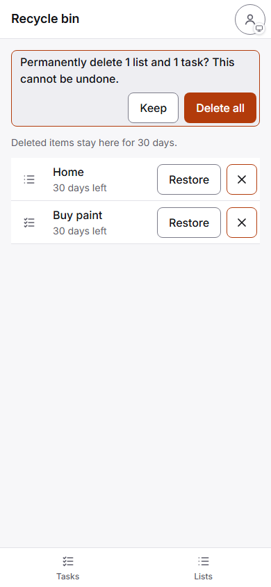

## Walkthrough & Validation

Screenshot: 

```text
$ npm test
 Test Files  59 passed (59)
      Tests  1193 passed (1193)
$ npm run lint
exit 0
$ npm run check:sw
OK: 75 precached files match VERSION 2026-11-08.13.
$ npx playwright test tests/e2e/bin-settings.spec.js

  6 passed (5.2s)
```
