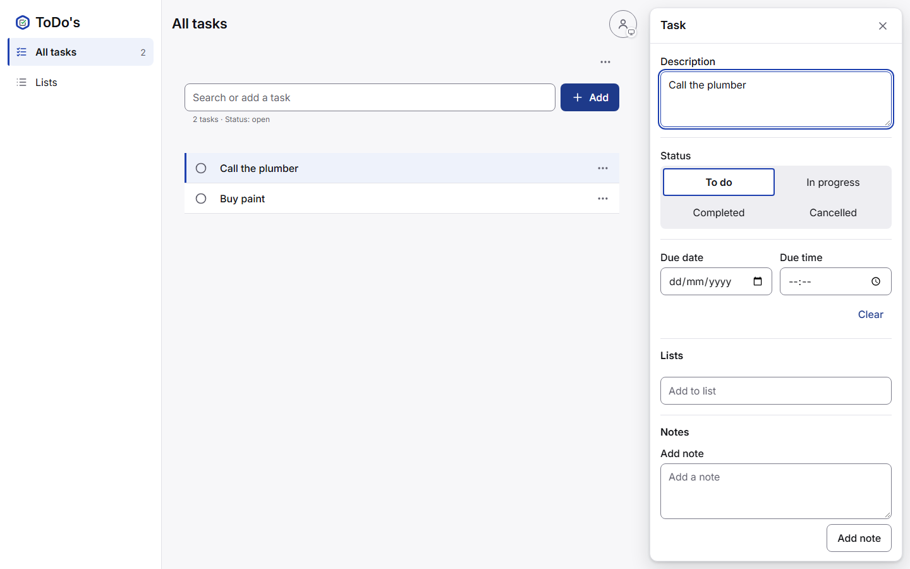
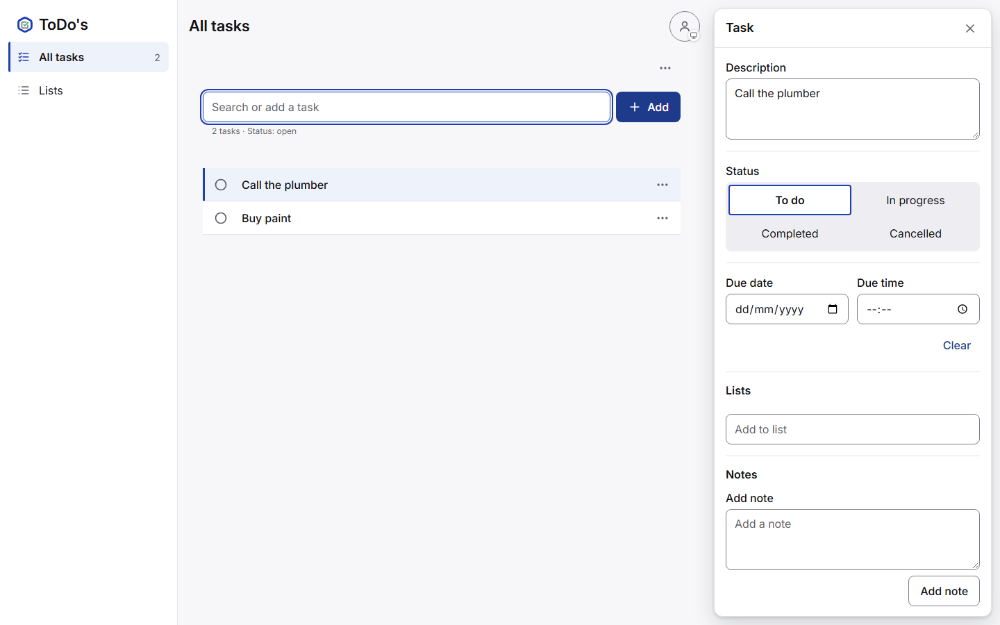
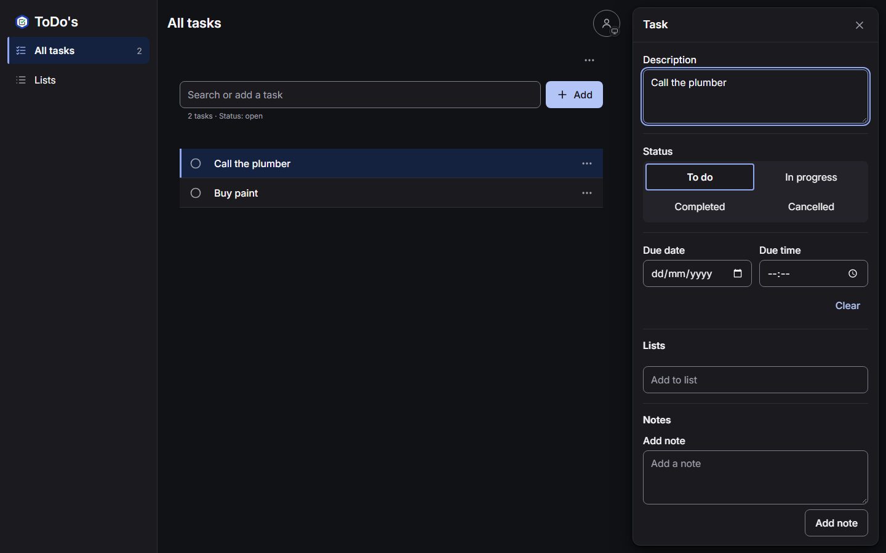
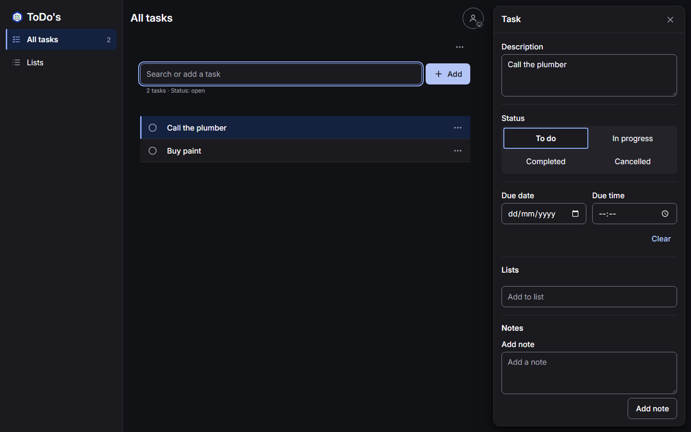
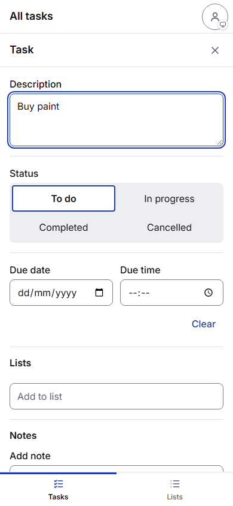

## Walkthrough & Validation

### Key Changes
- `task-editor.js` skips its first focus while the add field holds it outside the compact layout.
- `add-bar.js` always refocuses its field after a successful add; the `false` return of `onAdd` is gone.
- `all-tasks.js` and `list.js` no longer return `false` from their add handlers.
- Runs used a working tree that also held uncommitted T0214 edits (Settings About, `kbd` styles).

### Red Phase (before the fix)
`npx vitest run tests/unit/task-editor.test.js tests/unit/add-bar.test.js tests/unit/all-tasks.test.js tests/unit/list.test.js` (exit 1)
```text
     × takes the focus back after an add, from the Add button or wherever onAdd moved it 120ms
     × leaves the focus in the add field in the wide layout, so the next task can be typed 30ms
     × opens the task editor of a new task and gives the focus back to the add field 1142ms
     × opens the task editor of a new task in this list and gives the focus back to the add field 1109ms
[... failure details omitted ...]
 Test Files  4 failed (4)
      Tests  4 failed | 82 passed (86)
```

`npx playwright test tests/e2e/all-tasks.spec.js tests/e2e/list.spec.js` (exit 1)
```text
  7 failed
    [chromium] › tests\e2e\all-tasks.spec.js:124:1 › Add adds a task, opens it, keeps focus in the add bar, and asks for persistent storage once (TSK-1, TSK-13, TEC-5) 
    [chromium] › tests\e2e\all-tasks.spec.js:426:1 › typing in the add field searches, Enter never adds, and Add creates the task and clears the filter (VO-3, TSK-1) 
    [chromium] › tests\e2e\all-tasks.spec.js:458:3 › Shift+Enter in the add field adds tasks in a row, each opening in the editor (TSK-1, TSK-13) 
    [chromium] › tests\e2e\all-tasks.spec.js:458:3 › Alt+Enter in the add field adds tasks in a row, each opening in the editor (TSK-1, TSK-13) 
    [chromium] › tests\e2e\list.spec.js:76:3 › List screen › the add field filters the list rows, and Add puts the new task at the end of the list (VO-3, LV-5) 
    [chromium] › tests\e2e\list.spec.js:97:5 › List screen › Shift+Enter in the add field adds tasks in a row at the end of the list, keeping the focus (TSK-1, LV-5) 
    [chromium] › tests\e2e\list.spec.js:97:5 › List screen › Alt+Enter in the add field adds tasks in a row at the end of the list, keeping the focus (TSK-1, LV-5) 
  26 passed (1.5m)
```
The compact-layout e2e test passed already, since compact behavior does not change.

### Green Phase
`npx vitest run tests/unit/task-editor.test.js tests/unit/add-bar.test.js tests/unit/all-tasks.test.js tests/unit/list.test.js` (exit 0)
```text
 Test Files  4 passed (4)
      Tests  86 passed (86)
```

`npx playwright test tests/e2e/all-tasks.spec.js tests/e2e/list.spec.js` (exit 0)
```text
  ok 33 [chromium] › tests\e2e\list.spec.js:265:3 › List screen › a list of 300 tasks renders the rows in view, and moves and drags reach rows past them (TEC-16) (19.4s)

  33 passed (48.0s)
```

`npx vitest run` (exit 0)
```text
 Test Files  59 passed (59)
      Tests  1220 passed (1220)
```

`npx playwright test` (exit 1; two gallery tests timed out while a screenshot run shared the machine)
```text
  2 failed
    [chromium] › tests\e2e\gallery-app.spec.js:212:3 › every keyboard stop in the task row, status, and task list sections shows a focus ring at 1440 px 
    [chromium] › tests\e2e\gallery-chrome.spec.js:257:3 › every keyboard stop in the chrome sections shows a focus ring at 390 px 
  192 passed (3.6m)
```

`npx playwright test tests/e2e/gallery-app.spec.js tests/e2e/gallery-chrome.spec.js` (exit 0)
```text
  38 passed (29.2s)
```

`npx eslint .` (exit 0, no output)

`npm run check:sw` (exit 0)
```text
OK: 75 precached files match VERSION 2026-11-10.2.
```

### Visual Verification
Two adds by the Add button at 1440x900, one add at 390x844; HTTP 200 on both servers.
Both runs logged one page error from the harness itself: `serviceWorkers: 'block'` leaves `navigator.serviceWorker` undefined for `sw-update.js`.

| Case                | Before                                         | After                                        |
| :------------------ | :--------------------------------------------- | :------------------------------------------- |
| Wide, light         |  Description   |  Add field     |
| Wide, dark          |  Description    |  Add field      |
| Compact, light      |  Description |  Description |
