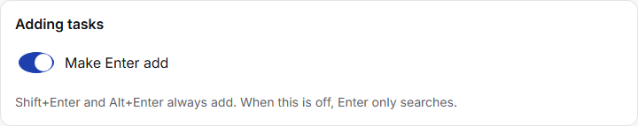
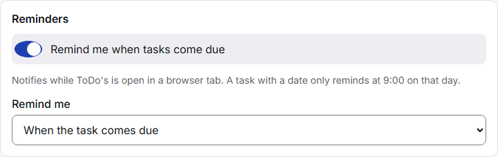
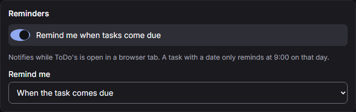

# T0226: Notify the user when a task comes due while the app is open, with opt-in and a lead time

## Goals
Alert the user when an open task comes due, in both modes, while the app is open in any tab.
- Settings gain an opt-in Reminders section that requests notification permission and offers a lead time.
- One tab schedules notifications through the service worker; clicking one opens the task editor.
- Each due time notifies once; edits re-arm it, and completing or deleting a task cancels it.
- Local mode still sends no network request (`LOC-3`).
- Reminders with the app closed follow in T0227.
- Motivation: [comparing-with-google-products.md](https://github.com/gpellicciotta/todos.server/blob/main/docs/comparing-with-google-products.md), section Reminders, Dates, and Calendar.

Completion check: `npm test` and the new reminders e2e spec pass.
Size estimate: 8 files, 350 lines.

## Task Execution Steps
- [x] **[Read]**      Read the preferences, settings, service worker, overdue, and tab coordination code.
- [x] **[Decide]**    Decide the date-only reminder time and how reminders missed while closed appear on start.
- [x] **[Implement]** Author failing unit tests for scheduling and an e2e spec with a mocked Notification API.
- [x] **[Verify]**    Run the new tests and confirm they fail for the right reasons.
- [x] **[Implement]** Implement the reminder scheduler, the Settings section, and the notification click handler.
- [x] **[Verify]**    Run the unit and e2e suites and confirm they pass.
- [x] **[Visual]**    Inspect the Settings section and a real notification in Chrome and Firefox on desktop.
- [x] **[Doc]**       Add reminder requirements, the Settings design, the wireframe, and a CHANGELOG.md entry.
- [ ] **[Review]**    Obtain review approval of the finished work before completion.

## Execution Log
- [2026-11-12] **[Doc]**
  Companion task file scaffolded at task creation.

- [2026-11-12] **[Doc]**
  Wrote goals, steps, and technical-spec.md from the Google products comparison in todos.server.

- [2026-11-16] **[Doc]**
  Added occurrence-aware due times and recurring reminders from T0224 and T0235; replaced the missing test:unit script with npm test.

- [2026-11-17] **[Decided]**
  Date-only tasks (23:59) remind at 09:00 on the due date; reminders missed while closed become one summary on start, only after the opt-in time.

- [2026-11-17] **[Visual]**
  Chromium light and dark screenshots saved; Firefox and real OS notifications not inspectable unattended; wireframe and manual check moved to T0268.

- [2026-11-17] **[Doc]**
  Added REM-1 to REM-10, the Settings design text, and a CHANGELOG entry; settings.svg wireframe deferred to T0268.

- [2026-11-17] **[Verify]**
  Recorded task outcomes.
  - Files touched: 8.
  - Lines touched: 420.
  - Reopenings: 0.

- [2026-11-17] **[Implement]**
  Added core/reminders.js, the Settings Reminders section, worker click handler, and app wiring; ledger tags dedupe per due time.

- [2026-11-17] **[Visual]**
  Before: . After: , .

- [2026-11-17] **[Verify]**
  Corrected outcomes measured with git diff --numstat: counted files and lines.
  - Files touched: 8.
  - Lines touched: 381.
  - Reopenings: 0.

- [2026-11-17] **[Review]**
  Round 1 requested (mode: agent).

