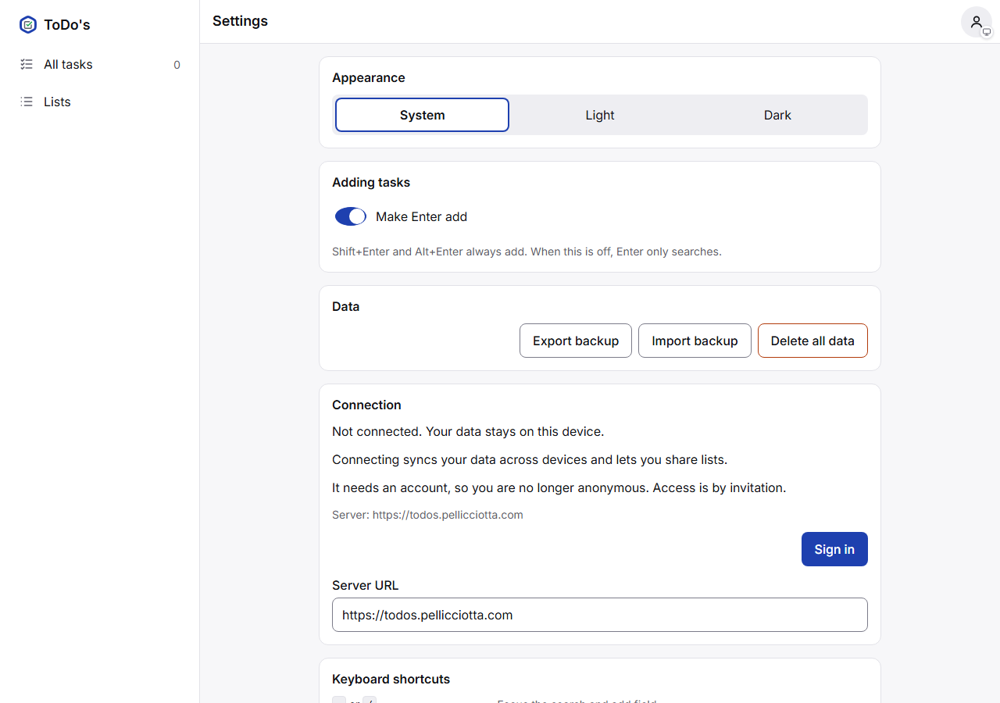
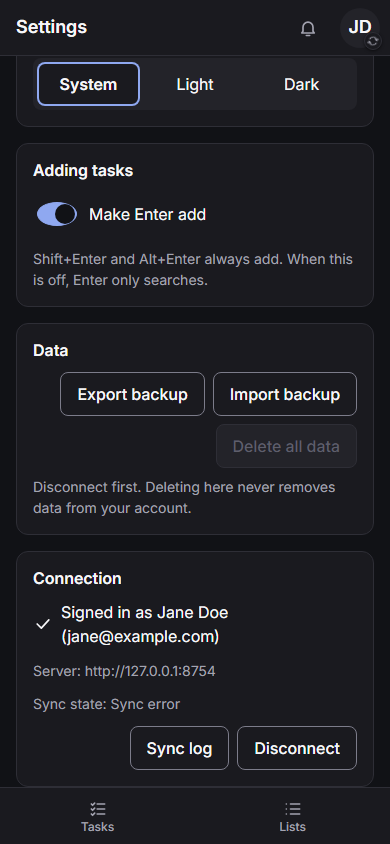
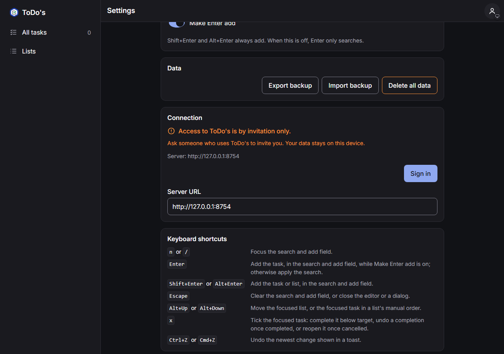
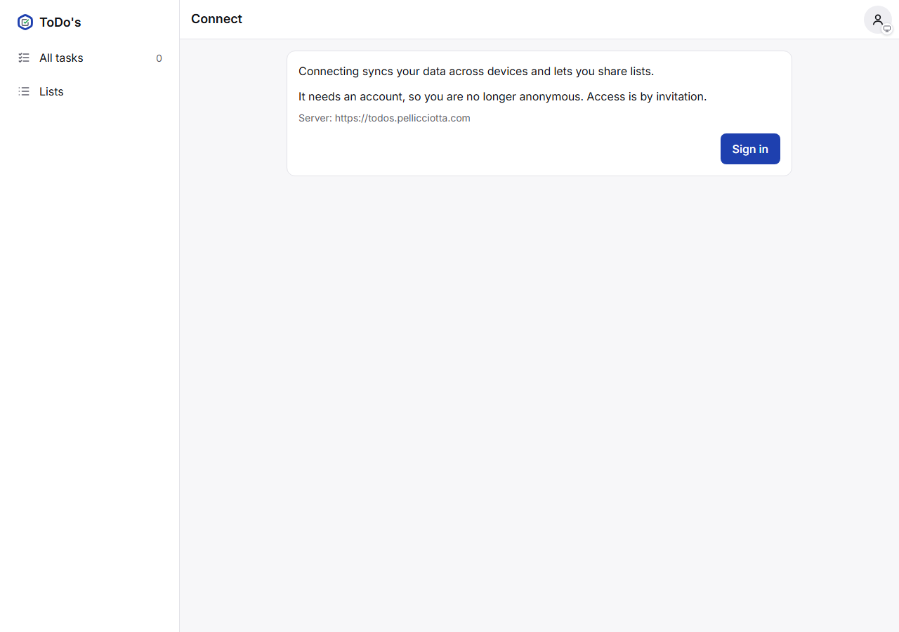

# T0245: Merge the connect screen into the Settings Connection section, keeping #/connect as an alias for the Auth return

## Goals
Make the Settings Connection section the only place to connect, removing the separate connect screen.
- The section shows every sign-in phase in place: intro, signing in, signed in, not invited, error, and expired.
- `#/connect` stays as an alias that opens Settings at the Connection section, so Auth needs no change.
- Links that open `#/connect` keep working through the alias.
- The user asked for one card: less visual clutter and easier to remember.
- Rules and tests: [technical-spec.md](T0245-merge-the-connect-screen-into-the-settings-connection/technical-spec.md).

## Task Execution Steps
- [x] **[Read]**      Read connect.js, the Settings Connection section, the router, and the Auth return in session.js.
- [x] **[Doc]**       Update the Settings design, the Connecting and Session Expiry flows, and the wireframes.
- [x] **[Implement]** Move the connect tests into Settings and router tests, and confirm they fail.
- [x] **[Verify]**    Run the moved tests and confirm they fail for the right reasons.
- [x] **[Implement]** Move the phases into the Connection section, alias the route, and remove connect.js.
- [x] **[Verify]**    Run the unit and e2e suites and confirm they pass.
- [x] **[Visual]**    Capture each phase in Settings, light and dark, at desktop and phone widths.
- [x] **[Doc]**       Update CHANGELOG.md.
- [x] **[Review]**    Obtain review approval of the finished work before completion.

## Execution Log
- [2026-11-16] **[Doc]**
  Companion task file scaffolded at task creation.

- [2026-11-16] **[Doc]**
  Wrote goals, steps, and technical-spec.md from the user's request for a single Connect card.

- [2026-11-16] **[Decided]**
  Folded in T0244: the Connection section drops the stale later-version sync hint, with a unit test.

- [2026-11-17] **[Verify]**
  Merged the connect screen into the Settings Connection section; #/connect aliases to Settings; connect.js removed. Unit 1570, e2e 223, lint pass; evidence in validation-proof.md.

- [2026-11-17] **[Read]**
  Read connect.js, the Settings Connection section, the router, app.js, layout.js, and session.js capture and finish.

- [2026-11-17] **[Doc]**
  Updated ui-design.md for the merged Connection section, the alias route, and flows; regenerated wireframes with the new Connection card.

- [2026-11-17] **[Implement]**
  Moved connect tests into settings, router, and layout unit tests; they failed first, 7 of 79. Then moved phases into Settings, aliased the route, and deleted connect.js.

- [2026-11-17] **[Verify]**
  Failing run showed 7 failures from missing behavior. After the change: unit 1570 passed, e2e 223 passed, eslint clean, sw hashes match.

- [2026-11-17] **[Visual]**
  Captured 24 after screenshots and 8 before-*.png shots of the old screen in screenshots/, covering light and dark, 1280 and 390 px.

- [2026-11-17] **[Doc]**
  Added two FrontEnd bullets under v0.5.1-pre in CHANGELOG.md; bumped service worker VERSION to 2026-11-17.10 and regenerated precache hashes.

- [2026-11-17] **[Visual]**
  Screenshots:   .

- [2026-11-17] **[Verify]**
  Test evidence: [validation-proof.md](T0245-merge-the-connect-screen-into-the-settings-connection/validation-proof.md).

- [2026-11-17] **[Visual]**
  Before and after:  then .

- [2026-11-17] **[Review]**
  Round 1 requested (mode: agent).

- [2026-11-17] **[Review]**
  Round 1 rejected by @codex: Rejected for one blocking sign-in lifecycle defect.
  - Findings: [review-findings-1.md](T0245-merge-the-connect-screen-into-the-settings-connection/review-findings-1.md).

- [2026-11-17] **[Implement]**
  Review D1 fixed: sign-in phase now lasts until its promise settles; added notification-order and expired-return tests. Unit 1574, e2e 223 pass.

- [2026-11-17] **[Review]**
  Round 2 requested (mode: agent).

- [2026-11-17] **[Review]**
  Round 2 approved by @codex: Approved.
  - Findings: [review-findings-2.md](T0245-merge-the-connect-screen-into-the-settings-connection/review-findings-2.md).

- [2026-11-17] **[Complete]**
  Task completed successfully.

