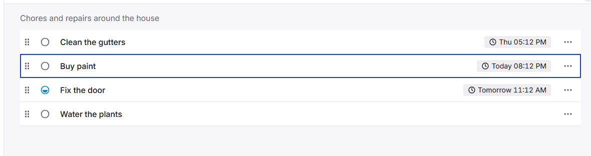
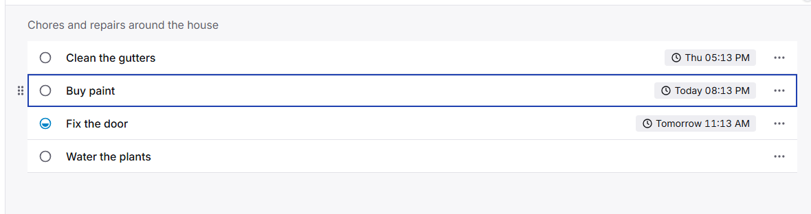
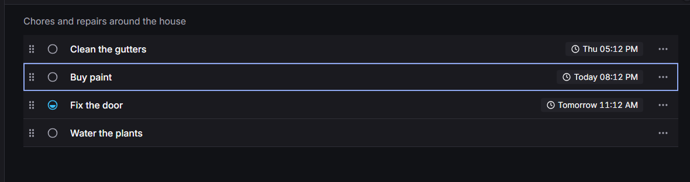
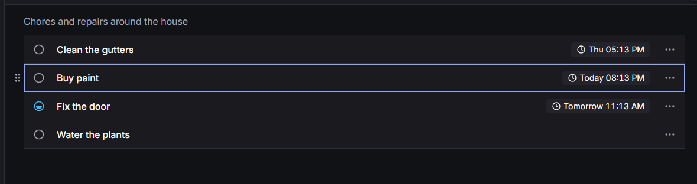
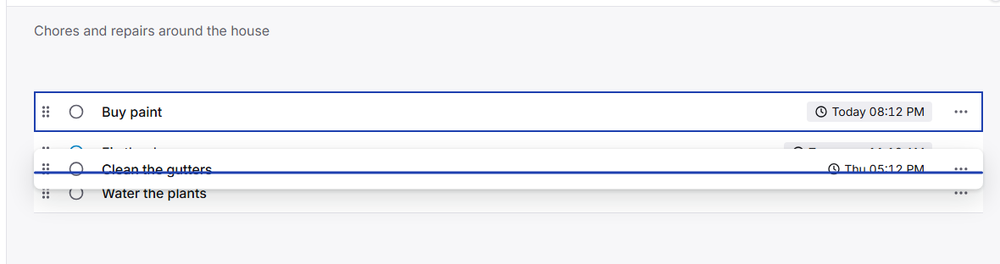
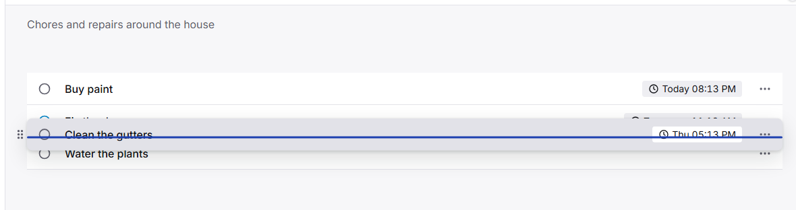
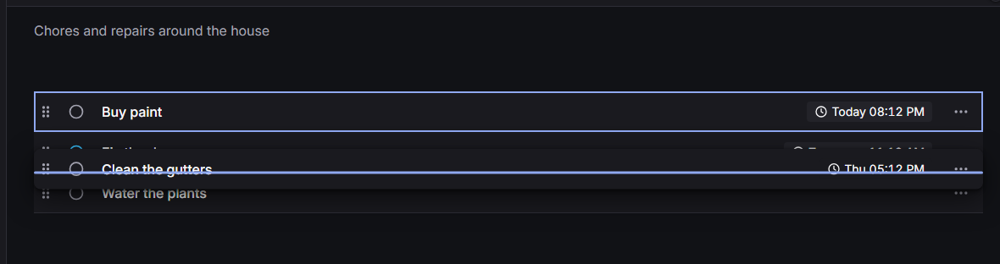
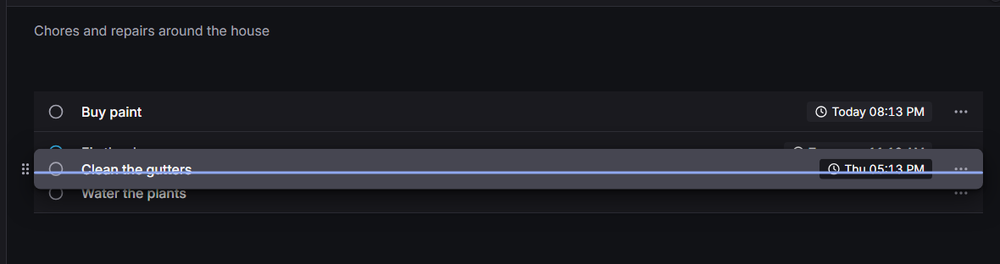

## Walkthrough & Validation

### Failing tests before the implementation

`npx vitest run tests/unit/reorder.test.js tests/unit/task-list.test.js` (filtered), exit code 1:

```text
 ❯ tests/unit/reorder.test.js (17 tests | 4 failed) 222ms
     × keeps a press that moves under 6 px a click, and drags past 6 px without opening the row 39ms
     × keeps the browser from dragging the open link or selecting text while row presses are on 9ms
     × starts a drag after a 400 ms touch hold with a short vibration, and lets a 10 px move scroll instead 16ms
     × moves the focused row to the top or bottom with Alt+Home and Alt+End when ends are on 13ms
 ❯ tests/unit/task-list.test.js (71 tests | 2 failed) 3603ms
       × drags a row by a press on its open link, never by its status button, and opens no editor on the drop (LV-3)
       × moves the focused row to the end with Alt+End and keeps focus on it in the new order (LV-3) 88ms
 FAIL  tests/unit/reorder.test.js > attachReorder > keeps a press that moves under 6 px a click, and drags past 6 px
AssertionError: expected undefined to be 'true' // Object.is equality
 FAIL  tests/unit/reorder.test.js > attachReorder > keeps the browser from dragging the open link or selecting text
AssertionError: expected false to be true // Object.is equality
 FAIL  tests/unit/reorder.test.js > attachReorder > starts a drag after a 400 ms touch hold with a short vibration,
AssertionError: expected undefined to be 'true' // Object.is equality
 FAIL  tests/unit/reorder.test.js > attachReorder > moves the focused row to the top or bottom with Alt+Home and
AssertionError: expected false to be true // Object.is equality
 FAIL  tests/unit/task-list.test.js > createTaskList > with a long list > drags a row by a press on its open link,
AssertionError: expected undefined to be 'true' // Object.is equality
 FAIL  tests/unit/task-list.test.js > createTaskList > with a long list > moves the focused row to the end with
AssertionError: expected "vi.fn()" to be called with arguments: [ 'm5', { …(2) } ]
 Test Files  2 failed (2)
      Tests  6 failed | 82 passed (88)
```

The guard test "starts no row drag from a button of the row, with moves off, or without the press option" passed
before the change, since no row press started drags then.

`npx playwright test tests/e2e/list.spec.js -g "pressing and dragging|grip shows outside|Alt\+End and Alt\+Home"` (filtered), exit code 1:

```text
    Error: expect(locator).toHaveCount(expected) failed
    Expected: 1
    Received: 0
    > 223 |     await expect(page.locator('.list-view .task-row[data-dragging="true"]')).toHaveCount(1);
    Error: expect(locator).toBeHidden() failed
    Expected: hidden
    Received: visible
    > 252 |       await expect(shown.nth(index).locator('.task-row__handle')).toBeHidden();
    Error: expect(received).toEqual(expected) // deep equality
    - Expected  - 1
    + Received  + 1
      277 |     await expect(page.locator('.list-view .task-row').nth(2).locator('.task-row__open')).toBeFocused();
  3 failed
```

### Passing tests after the implementation

`npm test` (tail), exit code 0, after the last code change:

```text
 Test Files  65 passed (65)
      Tests  1734 passed (1734)
   Duration  23.55s (environment 45%, tests 43%, import 7%, transform 3%, worker 1%, setup 1%)
```

`npx playwright test tests/e2e/list.spec.js tests/e2e/gallery-app.spec.js tests/e2e/lists.spec.js` (summary), exit code 0:

```text
  51 passed (1.9m)
```

`npx eslint .`, exit code 0, with no output.

`npm run check:sw` after bumping VERSION and `node scripts/check-sw-version.mjs --update`, exit code 0:

```text
OK: 131 precached files match VERSION 2026-11-17.27.
```

### Full e2e suite

`npx playwright test --reporter=list` (summary and failure), exit code 1:

```text
  1) [chromium] › tests\e2e\behaviors-dialog.spec.js:77:3 › toast behavior › keyboard alone shows a toast, reaches its Undo, and undoes
    Error: strict mode violation: locator('[aria-live="polite"]') resolved to 2 elements:
        1) <span aria-live="polite" class="task-editor__count">1 of 3</span> aka getByText('1 of 3', { exact: true })
        2) <div role="status" aria-live="polite" aria-atomic="true" class="visually-hidden" data-live-region="polite">Task moved to the recycle bin.</div>
  1 failed
  254 passed (4.1m)
```

The same test fails on the main checkout at 23563c4, so it predates this task; backlog task T0279 tracks it.

### Visual verification
Captured at 1440 px by a throwaway Playwright harness serving each checkout.
It asserted HTTP 200, no console errors, no page errors, no failed requests, and no status 400 or higher.

| State                  | Before                                                  | After                                                 |
| :--------------------- | :------------------------------------------------------ | :---------------------------------------------------- |
| Focused row, light     |                  |                  |
| Focused row, dark      |                   |                   |
| Drag in progress, light |                        |                         |
| Drag in progress, dark |                          |                          |

Before, every row reserves a handle column; after, only the focused or dragged row shows a grip, in the gutter.
The after drag starts from a press on the row's description; the before drag needs the handle.
Touch holds are covered by unit tests only; no touch device or touch emulation run was made.
